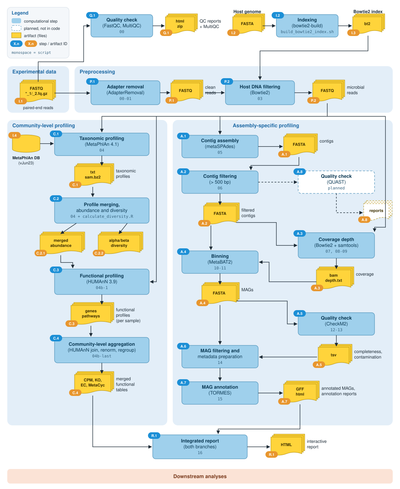
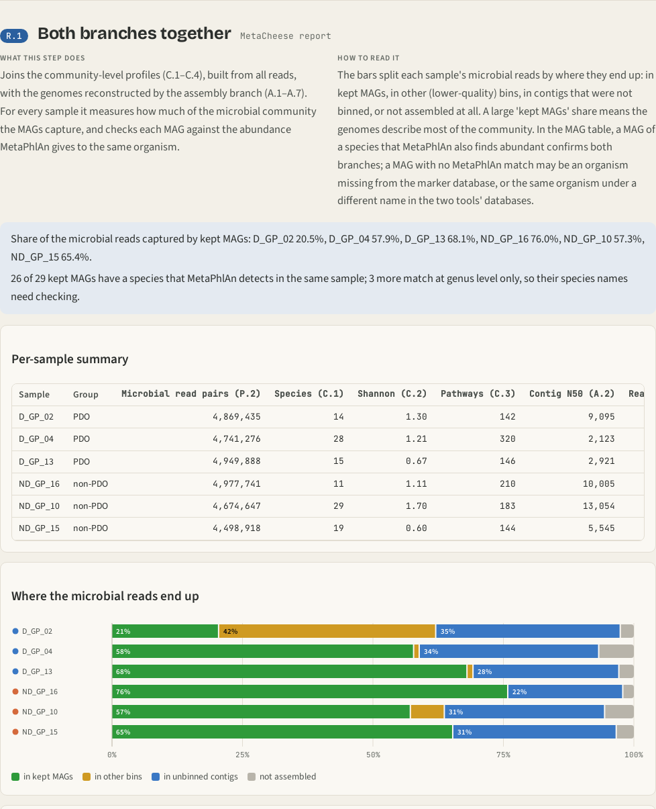

# MetaCheese

MetaCheese is a containerised pipeline for shotgun metagenomic studies, with
host DNA removal as one of its steps. From paired-end
FASTQ files it produces taxonomic and functional profiles of the community,
diversity measures, metagenome-assembled genomes (MAGs) and one interactive
HTML report of the whole run.

- **One Docker image** holds every tool and database: nothing to install
  besides Docker.
- **Plain Bash steps** generated from templates and one YAML config: easy to
  read, rerun or resume from any step.
- **Reproducible runs**: each run writes numbered result folders together with
  the exact config it used, its log and the time spent in each step.

## Why one pipeline for both analyses

> **Running community profiling and genome reconstruction as two separate
> projects gives two sets of results that cannot be compared directly.
> MetaCheese runs both analyses on the same reads, in the same environment,
> and joins them in one report, where each analysis checks the other.**

- **Each analysis validates the other.** The joint step (R.1) matches every
  MAG to the species MetaPhlAn finds in the same sample. It also corrects for
  the 2020 renaming of *Lactobacillus*, which the two tools' databases do not
  share. Done by hand, this is easy to miss: in the small example 16 of the
  29 kept MAGs would have no species match; with it, 26 match a MetaPhlAn
  species, and the other 3 match only at genus level.
- **Answers that neither analysis gives alone.** How much of each community
  the genomes actually describe: in the small example, kept MAGs hold 21-76%
  of each sample's microbial reads. Which abundant species have no genome
  (too little coverage, or strain mixtures), and which genomes belong to
  organisms missing from the marker database.
- **Tools that do not install together.** The two analyses need more than a
  dozen tools with conflicting requirements (Python 2.7 for Bowtie2, 3.7 for
  HUMAnN, 3.10 for QUAST, ...) and their databases. The image has them in
  separate environments with pinned versions, so every run uses the same
  software.
- **One config, one command, one record.** Threads, memory and thresholds of
  both analyses are in one YAML file; each run keeps its config, log and step
  times, and can be resumed from any step.
- **One report.** The results of both analyses, explained step by step, in a
  single HTML file that can be e-mailed to colleagues who do not use the
  command line.



---

## Quick start

The fastest way to see MetaCheese work end to end is the small example:
6 cheeses from the public BioProject
[PRJNA1198075](https://www.ebi.ac.uk/ena/browser/view/PRJNA1198075), 5 million
read pairs each, on a 16-core / 64 GB machine.

```bash
# 1. Get the code and build the image (several hours the first time, ~120 GB)
git clone https://github.com/synbionics/MetaCheese.git
cd MetaCheese
docker build -t metacheese .

# 2. Download the host genome (Bos taurus ARS-UCD2.0); its index is built on the first run
mkdir -p data/gene/Bos_taurus
curl -L https://ftp.ncbi.nlm.nih.gov/genomes/all/GCA/002/263/795/GCA_002263795.4_ARS-UCD2.0/GCA_002263795.4_ARS-UCD2.0_genomic.fna.gz \
    | gunzip > data/gene/Bos_taurus/GCA_002263795.4_ARS-UCD2.0_genomic.fna

# 3. Download the 6 example samples (first 5M read pairs of each, ~3.5 GB)
bash examples/small_PRJNA1198075/prepare_input.sh

# 4. Run the whole pipeline
bash examples/small_PRJNA1198075/run_example.sh
```

Step 3 streams the reads from ENA and stops after the first 5 million pairs
of each file, so the full dataset (125 GB) is never downloaded. The run
takes about 9 hours on a 16-core / 62 GB workstation and ends with the report in
`output/example_small/report/report.html`. Details are in the
[small example README](examples/small_PRJNA1198075/README.md).

---

## What it does

After a quality check, adapter trimming and host DNA removal, the reads follow
two branches:

- **community-level profiling**: which organisms are present (MetaPhlAn),
  what they can do (HUMAnN), and how samples differ (alpha/beta diversity);
- **assembly-specific profiling**: assembly (metaSPAdes), binning into MAGs
  (MetaBAT2), MAG quality (CheckM2) and annotation of the good MAGs (TORMES).

A final joint step (R.1) brings the two branches together in one interactive
report. It reads the outputs of every step (dashed purple lines in the
figure) and adds a section that combines them: how much of each community
the MAGs capture, and whether the MAGs match the species the community
profiles found.

Step IDs (blue in the figure) and artifact IDs (orange) are used throughout
the docs, the scripts and the report. When a step writes both data passed to
the next step and logs or side files, these are separate artifacts
(e.g. P.1.1 trimmed reads, P.1.2 trimming settings). The script column is the pipeline step
name (`scripts/templates/template_<script>*.sh`), also used with `--from`/`--to`.

| ID | Step | Tool (version in the image) | Script | Output folder |
|----|------|-----------------------------|--------|---------------|
| Q.1 | Quality check of raw reads | FastQC 0.12.1, MultiQC 1.35 | `00` | `00_fastqc/` |
| I.2 | Host genome index (once per host) | Bowtie2 2.3.3.1 | `scripts/build_bowtie2_index.sh` | `data/gene/<Host>/` |
| P.1 | Adapter and quality trimming | AdapterRemoval 2.3.3 | `00-01` | `01_AdapterRemoval/` |
| P.2 | Host DNA removal | Bowtie2 2.3.3.1 | `03` | `03_bowtie2_output/` |
| C.1 | Taxonomic profiling | MetaPhlAn 4.1.0, db `mpa_vJun23_CHOCOPhlAnSGB_202307` | `04` | `04_metaphlan_output/` |
| C.2 | Merged abundances, alpha/beta diversity | MetaPhlAn utils, R 4.3 | `04` | `04_metaphlan_output/diversity/` |
| C.3 | Functional profiling (per sample) | HUMAnN 3.9 (ChocoPhlAn v201901_v31, UniRef90) | `04b-1` | `04b_humann_output/` |
| C.4 | Community-level aggregation of the functional profiles | HUMAnN 3.9 utilities | `04b-last` | `04b_humann_output/merged_tables/` |
| A.1 | Metagenome assembly (per sample) | metaSPAdes 3.13.0 | `05` | `05_spades_output/` |
| A.2 | Contig filtering (> 500 bp) | awk | `06` | `05_spades_output/contigs/filtered/` |
| A.8 | Assembly quality (all samples side by side) | QUAST 5.3.0 | `06b` | `06b_quast/` |
| A.3 | Read mapping to the contigs | Bowtie2, samtools 1.6 | `07`, `08-09` | `07_Bowtie_Index/`, `08_mapping_coverage/` |
| A.4 | Contig coverage and binning into MAGs | MetaBAT2 2.17 | `10-11` | `10_metabat_depth/`, `11_metabat_MAG/` |
| A.5 | MAG completeness and contamination | CheckM2 1.0.2 | `12-13` | `13_checkm2/` |
| A.6 | MAG filtering and metadata | awk | `14` | `14_MAGs_high_quality/` |
| A.7 | MAG annotation | TORMES 1.3.0 | `15` | `15_tormes_MAGs/` |
| R.1 | Integrated report of both branches | Python 3 (`scripts/report/make_report.py`) | `16` | `report/` |

Inputs, outputs, config keys and known issues of every step are in
[`docs/steps.md`](docs/steps.md).

---

## Requirements

- Linux with **Docker** ≥ 20.10 (Docker Desktop on macOS/Windows works, with
  slower disk access).
- **Disk**: about **120 GB for the image** (the MetaPhlAn, HUMAnN, CheckM2 and
  TORMES databases are inside it), plus 3-5 times the size of your compressed
  FASTQ files for the results.
- **CPU / RAM**: 16 cores and 64 GB RAM for the small example. On full
  datasets metaSPAdes needs the most memory: plan for 128 GB RAM or more and
  32+ cores.

---

## Running on your own data

### 1. Host genome

Put the host genome FASTA in `data/gene/<Host>/` (see Quick start, step 2, for
*Bos taurus*). For another host, use another folder name, set `step03.dir3` in
the config to `../../data/gene/<Host>/<Host>` and run with
`HOST_SPECIES=<Host>`. The Bowtie2 index is built the first time (about 40 min
with 16 threads for *Bos taurus*).

### 2. Input files

Create one folder under `input/` per dataset, with one pair of gzipped FASTQ
files per sample:

```
input/my_dataset/
├── sampleA_1.fq.gz   sampleA_2.fq.gz
└── sampleB_1.fq.gz   sampleB_2.fq.gz
```

`_L1`/`_L2` instead of `_1`/`_2` also works. Sample names must not contain
dots. Files from ENA/SRA (`SRRxxxx_1.fastq.gz`) must be renamed; the
`prepare_input.sh` scripts in [`examples/`](examples/) show how.

### 3. Config

Copy `config/Config.yml` and adapt threads and memory to your machine (the
defaults fit 16 cores / 64 GB). The keys you are most likely to change:

| Key | Meaning | Default |
|-----|---------|---------|
| `step*.par1` | threads of each step | 8-16 |
| `step05.par2` | metaSPAdes memory limit (GB), keep below the machine RAM | 56 |
| `step04b_1.par2` | DIAMOND block size for HUMAnN, higher is faster (~6 GB RAM per unit) | 2 |
| `step14.var5`, `var6` | MAGs kept: completeness above, contamination below (%) | 50, 10 |

All keys and how they reach the scripts: [`docs/configuration.md`](docs/configuration.md).

### 4. Run

```bash
bash examples/run_in_docker.sh --input my_dataset --name my_run --config config/Config.yml
```

This starts the container with the right folders mounted, builds the host
index if missing, runs every step and gives the output files back to your user.

- `--from <step>` / `--to <step>` run part of the pipeline; `<step>` is a
  script name from the table above (`04b-1`, `05`, `12-13`, ...).
- **Resume** an interrupted run with the same `--name` and `--from` the step
  that stopped (example below).
- The log is `output/<name>/run_<timestamp>.log`; the time of each step is in
  `output/<name>/step_times.tsv`.
- Environment variables: `HOST_SPECIES` (default `Bos_taurus`),
  `INDEX_THREADS`, `IMAGE` (default `metacheese`), `STEP14_CHOICE` (see A.6 in
  [`docs/steps.md`](docs/steps.md)).

#### Resuming an interrupted run

If a run stops (error, reboot, power cut), find the step that was running,
the last `Executing` line of the newest log, and start again from it with the
same `--name`:

```bash
grep Executing "$(ls -t output/my_run/run_*.log | head -1)" | tail -1
#  [2026-11-03 09:08:39] Executing 04b-1.humann_job_array.sh

bash examples/run_in_docker.sh --input my_dataset --name my_run --config config/Config.yml --from 04b-1
```

The steps before `04b-1` are not run again, and their results are kept. The
resumed run uses the run's saved `output/my_run/config.yml`, so later edits to
`config/Config.yml` do not change it. Within the step, HUMAnN skips the
samples that are already finished; the other steps start over. For the small
example the same is `bash examples/small_PRJNA1198075/run_example.sh --from 04b-1`.
If files in `output/my_run/` give `Permission denied`, see
[`docs/troubleshooting.md`](docs/troubleshooting.md).

Other ways to start the pipeline (interactive menu, your own container) are
in [`docs/configuration.md`](docs/configuration.md#other-ways-to-run).

---

## Results

Start from two pages:

- **`report/report.html`**: the final report. One self-contained file (no
  internet needed, can be sent by e-mail) that explains each step and shows
  its results (read quality and trimming, host removal, taxonomic and
  functional profiles, diversity, assemblies, MAGs, run times), then joins the
  two branches: share of each sample captured by the MAGs, and MAGs matched
  to the species found by MetaPhlAn.
- **`00_fastqc/multiqc_report.html`**: the quality of the raw reads, all
  samples on one page.



All files of a run:

```
output/<run>/
├── config.yml               resolved config used by this run
├── run_<timestamp>.log      full log of the run
├── step_times.tsv           seconds spent in each step
├── 00_fastqc/               Q.1  multiqc_report.html + FastQC html/zip per FASTQ file (R1 and R2)
├── 01_AdapterRemoval/       P.1  <s>_cleaned_L1/L2.fq.gz, <s>.settings (trimming stats)
├── 03_bowtie2_output/       P.2  <s>.unmapped.fq.1/2.gz (microbial reads), <s>.bowtie2.log
├── 04_metaphlan_output/     C.1  <s>.unmapped.txt profiles, merged_abundance_table.txt
│   └── diversity/           C.2  alpha (richness, shannon, simpson, gini) and beta (bray-curtis, jaccard, clr)
├── 04b_humann_output/       C.3  <s>.unmapped.fq_genefamilies/pathabundance/pathcoverage.tsv
│   └── merged_tables/       C.4  joined + CPM tables, KO / EC / MetaCyc reaction tables
├── 05_spades_output/        A.1  one metaSPAdes folder per sample
│   └── contigs/filtered/    A.2  <s>.fasta_sort.fasta (contigs > 500 bp)
├── 06b_quast/               A.8  report.html, report.tsv, icarus.html (assembly statistics)
├── 07_Bowtie_Index/         A.3  Bowtie2 index of each sample's contigs
├── 08_mapping_coverage/     A.3  sorted BAM, idxstats, mapping logs
├── 10_metabat_depth/        A.4  <s>.depth.txt (contig coverage)
├── 11_metabat_MAG/          A.4  bins <s>.<n>.fa
├── 13_checkm2/              A.5  quality_report.tsv
├── 14_MAGs_high_quality/    A.6  MAGs passing the filter + TORMES metadata
├── 15_tormes_MAGs/          A.7  TORMES annotation and report
└── report/                  R.1  report.html (both branches)
```

`scripts/clean_output_folders.sh` deletes the bulky intermediate files of a
run (the folders and files to keep are listed at the top of the script).

---

## Examples

Both use the public dataset PRJNA1198075 (Grana-type hard cheeses, PDO Grana
Padano and non-PDO).

| Example | Data | Machine | Instructions |
|---------|------|---------|--------------|
| [`small_PRJNA1198075`](examples/small_PRJNA1198075/) | 6 cheeses (3 PDO, 3 non-PDO), first 5M read pairs each | 16 cores, 64 GB RAM | [README](examples/small_PRJNA1198075/README.md) |
| [`PRJNA1198075`](examples/PRJNA1198075/) | all 28 cheeses (13 PDO, 15 non-PDO), 30-85M read pairs each | ≥ 32 cores, ≥ 128 GB RAM | [README](examples/PRJNA1198075/README.md) |

---

## Known limitations

- **HUMAnN uses only read 1** of each pair. HUMAnN ignores pairing anyway;
  concatenating both mates is the usual alternative.
- **Binning uses single-sample coverage**: each sample's contigs are binned
  with the depth from that sample only. Multi-sample coverage would give
  better bins.
- **No UniFrac**: there is no phylogenetic tree for the MetaPhlAn vJun23
  database.
- **Step 14 moves** (does not copy) the MAGs that pass the filter out of
  `11_metabat_MAG/`, and stops the pipeline if none passes, so TORMES does not
  run. With shallow data, as in the small example, few or no MAGs may pass.
- **CheckM (v1)** is installed but only CheckM2 is run.

Problems and fixes: [`docs/troubleshooting.md`](docs/troubleshooting.md).

---

## Citation

If you use MetaCheese, please cite the MetaCheese manuscript (in preparation)
and the tools it runs:

- **FastQC**: Andrews S. (2010). FastQC: a quality control tool for high throughput sequence data. https://www.bioinformatics.babraham.ac.uk/projects/fastqc/
- **MultiQC**: Ewels et al. (2016). *Bioinformatics* 32(19):3047-3048. https://doi.org/10.1093/bioinformatics/btw354
- **AdapterRemoval v2**: Schubert, Lindgreen and Orlando (2016). *BMC Research Notes* 9:88. https://doi.org/10.1186/s13104-016-1900-2
- **Bowtie2**: Langmead and Salzberg (2012). *Nature Methods* 9:357-359. https://doi.org/10.1038/nmeth.1923
- **MetaPhlAn 4**: Blanco-Míguez et al. (2023). *Nature Biotechnology* 41:1633-1644. https://doi.org/10.1038/s41587-023-01688-w
- **HUMAnN 3**: Beghini et al. (2021). *eLife* 10:e65088. https://doi.org/10.7554/eLife.65088
- **metaSPAdes**: Nurk et al. (2017). *Genome Research* 27:824-834. https://doi.org/10.1101/gr.213959.116; Prjibelski et al. (2020). *Current Protocols in Bioinformatics* 70:e102. https://doi.org/10.1002/cpbi.102
- **SAMtools**: Danecek et al. (2021). *GigaScience* 10(2):giab008. https://doi.org/10.1093/gigascience/giab008
- **MetaBAT 2**: Kang et al. (2019). *PeerJ* 7:e7359. https://doi.org/10.7717/peerj.7359
- **CheckM2**: Chklovski et al. (2023). *Nature Methods* 20:1203-1212. https://doi.org/10.1038/s41592-023-01940-w
- **TORMES**: Quijada et al. (2019). *Bioinformatics* 35(21):4207-4212. https://doi.org/10.1093/bioinformatics/btz220

## License

MetaCheese is released under the [MIT License](LICENSE). The tools and
databases inside the Docker image keep their own licenses.

## Credits

Pipeline development: Dorin Nicorean (Bash version), Davide Perazzoli
(Nextflow version, branch `Nextflow`), Vincenzo Bonnici. Synbionics group.
